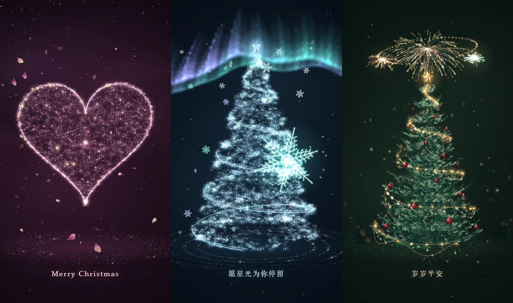

# Christmas-tree

三款用 Canvas 绘制的互动粒子圣诞树，每款都是一个可以离线打开的 HTML 文件。[下载项目 ZIP](https://github.com/yixi0721/Christmas-tree/archive/refs/heads/main.zip)

解压后双击任意一款。用手指或鼠标横向拖动可以旋转，轻点画面可以触发各自的效果。

| HTML 样本 | 点击效果 | 场景源码 |
| --- | --- | --- |
| [玫瑰星愿](./玫瑰星愿.html) | 旋转的玫瑰粉爱心散成星云，再聚成同色的圣诞树。再点一次，星光回到心口。 | [rose.js](./src/rose.js) |
| [冰晶回旋](./冰晶回旋.html) | 指尖长出一朵六瓣霜花，附近的雪悬停片刻，再碎成向上飞的冰晶。 | [ice.js](./src/ice.js) |
| [平安夜灯火](./平安夜灯火.html) | 火种从最近的灯沿枝头传到树顶，绽放烟花与金雨。点树脚可以看完整条灯路。 | [fir.js](./src/fir.js) |



## 修改和构建

只想做一份礼物时，用文本编辑器打开任意一个成品，搜索 `SETTINGS`。`color` 设置树身主色，`particleCount` 设置粒子数量，`greeting` 设置祝福语。《玫瑰星愿》还可以用 `heartColor` 单独设置爱心与夜空的主光色。

维护整套样本时，先修改三款的默认设置，再在项目根目录用 Node.js 运行以下命令。[默认设置与构建脚本](./src/build.mjs)

```sh
node src/build.mjs
```

命令会重新生成三款 HTML，并生成可离线阅读的《制作教程.html》，里面有改色、写祝福和录制竖屏演示的步骤。
