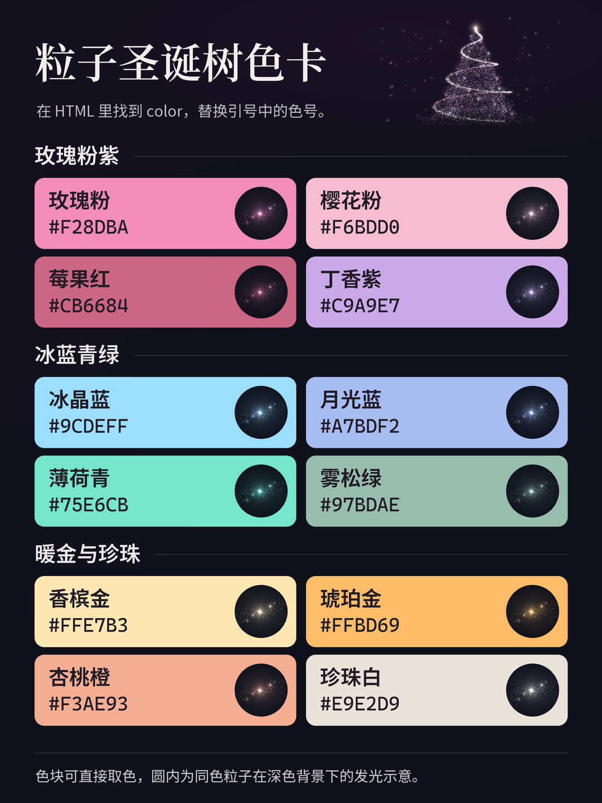

# Christmas-tree

三款用 Canvas 绘制的互动粒子圣诞树，每款都是一个可以离线打开的 HTML 文件。[下载项目 ZIP](https://github.com/yixi0721/Christmas-tree/archive/refs/heads/main.zip)

解压后双击任意一款。用手指或鼠标横向拖动可以旋转，轻点画面可以触发各自的效果。

| HTML 样本 | 点击效果 | 场景源码 |
| --- | --- | --- |
| [玫瑰星愿](./玫瑰星愿.html) | 旋转的玫瑰粉爱心散成星云，再聚成同色的圣诞树。再点一次，星光回到心口。 | [rose.js](./src/rose.js) |
| [冰晶回旋](./冰晶回旋.html) | 指尖长出一朵六瓣霜花，附近的雪悬停片刻，再碎成向上飞的冰晶。 | [ice.js](./src/ice.js) |
| [平安夜灯火](./平安夜灯火.html) | 火种从最近的灯沿枝头传到树顶，绽放烟花与金雨。点树脚可以看完整条灯路。 | [fir.js](./src/fir.js) |


## 填写信件正文

用记事本打开想送出的那一款 HTML，在文件开头的 `SETTINGS` 中找到下面这一行。把光标放在两个反引号之间，输入正文，直接按回车换行。空行也会保留。保存后刷新页面即可。这一项与树下的 `greeting` 分开填写。

```js
letter: ``
```

点主景右下方的花苞、六瓣冰晶或小提灯开信。成字时点右侧可加速。点「收起」后，可从右上角的信封重读，点「重播」则恢复最初的主题物件。

## 用智能体定制圣诞树

复制下面整段发给智能体，换成你想要的款式、色号和祝福语。《玫瑰星愿》可以分别设置两种颜色。选《冰晶回旋》或《平安夜灯火》时，只需填写树身颜色和祝福语。

```text
请帮我定制《玫瑰星愿》，树身用（自定义（六位十六进制色值）），爱心和夜空的主光色用（自定义），祝福语写“（自定义）”。

请从下面的 GitHub 仓库下载与款式同名的 HTML 文件：
https://github.com/yixi0721/Christmas-tree

只修改文件开头的 SETTINGS。请把我选的六位十六进制色值填入 color 和 heartColor（仅玫瑰款），祝福语原样填入 greeting。如果我另附信件正文，填入 letter 并保留原有换行和空行。

把成品另存为“款式名-定制版.html”，让我双击就能离线打开。如果你能操作我的电脑，请直接保存到我的“下载”文件夹，并告诉我完整路径。如果通过聊天交付，请把改好的 HTML 作为可下载的附件发给我。
```

## 粒子色卡

用记事本打开想改的 HTML，搜索 `const SETTINGS`。把 `color` 引号里的色号换成下图中的任意一种，保留开头的 `#`，保存后刷新网页。

《玫瑰星愿》还可以用 `heartColor` 单独设置爱心与夜空的主光色。试试把 `heartColor` 设为玫瑰粉 `#F28DBA`、`color` 设为香槟金 `#FFE7B3`，轻点后，粉色爱心就会散开，聚成金色圣诞树。

[](./粒子圣诞树色卡.png)

<details>
<summary>展开 12 个可复制的色号</summary>

| 玫瑰粉紫 | 冰蓝青绿 | 暖金与珍珠 |
| --- | --- | --- |
| 玫瑰粉 `#F28DBA` | 冰晶蓝 `#9CDEFF` | 香槟金 `#FFE7B3` |
| 樱花粉 `#F6BDD0` | 月光蓝 `#A7BDF2` | 琥珀金 `#FFBD69` |
| 莓果红 `#CB6684` | 薄荷青 `#75E6CB` | 杏桃橙 `#F3AE93` |
| 丁香紫 `#C9A9E7` | 雾松绿 `#97BDAE` | 珍珠白 `#E9E2D9` |

</details>

## 修改和构建

同一段 `SETTINGS` 里的 `particleCount` 设置粒子数量，`greeting` 设置祝福语。维护源码时，可以在下面的构建脚本里分别填写三款的 `letter`，重新构建时会带入各自的正文。

维护整套样本时，先修改三款的默认设置，再在项目根目录用 Node.js 运行以下命令。[默认设置与构建脚本](./src/build.mjs)

```sh
node src/build.mjs
```

命令会重新生成三款 HTML，并生成可离线阅读的《制作教程.html》，里面有改色、写祝福和录制竖屏演示的步骤。
